# Testing and results

## 1. System test with a potentiometer

To check that the Arduino, ADC and Python code communicate correctly, the sensor was
temporarily replaced with a potentiometer, which gives an easily controlled voltage:

1. Place the potentiometer on a breadboard.
2. Connect its outer pins to Arduino 5 V and GND, and the middle pin to the
   (+) of the converter's input connector. Connect the (-) of that connector to GND.
3. Connect the Arduino to the PC, upload the sketch and set the correct serial port
   in the Python script.
4. Run the script and turn the potentiometer for 10 seconds until the graph appears.

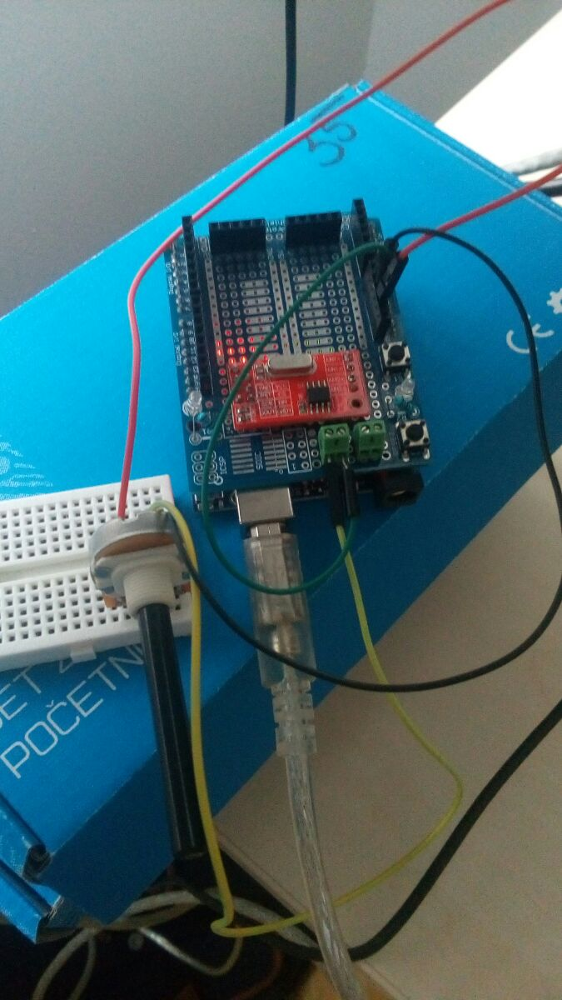

**Outcome:** the graph showed the voltage changes as 16-bit values (0 to 65535) over 10 seconds.
The program also prints the maximum value and the samples per second (SPS):
**492 SPS**, close to the 500 Hz target, which confirmed that the serial link and
data rate work.

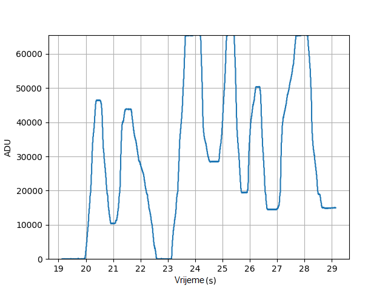

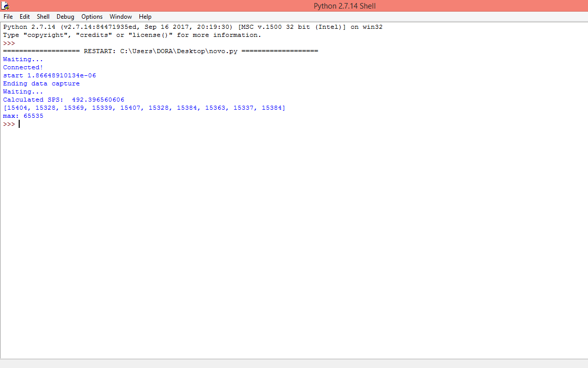

## 2. Street lamp measurement

The sensor was pointed at a street lamp, with all other parts of the device in a darkened room.
The Arduino's status LEDs were covered with dark material so they would not affect the sensor.

- A 10-second recording shows the light signal over time.
- With only one photodiode connected, the signal was lower than it should be because
  not the whole intended area was covered. The fix was to connect photodiodes in
  parallel (two per input).
- In a one-second zoom, about **51 periods** were counted instead of exactly 50, suggesting a small
  deviation in the mains frequency. This shows the sensor can pick up very small frequency deviations.

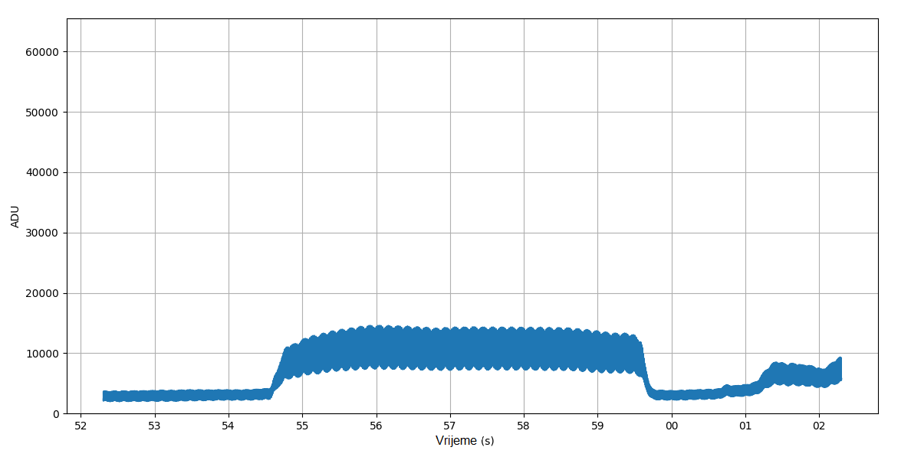

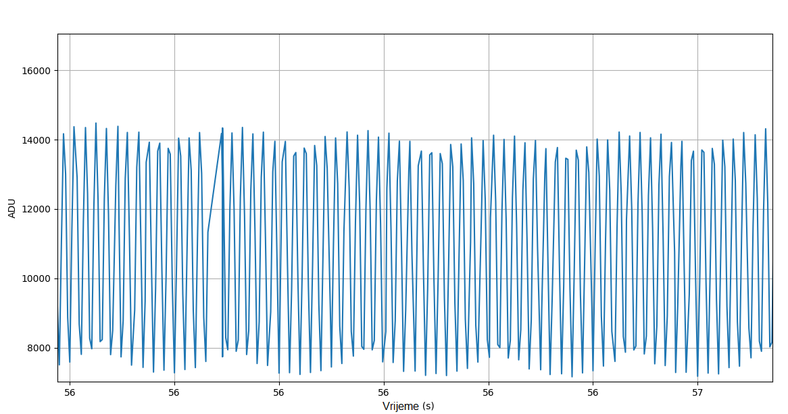

## 3. Lightning measurement

During a night thunderstorm the device was placed in a window of a darkened room, with the
photodiodes facing the sky. Each 10-second block was saved automatically to a CSV file
(about 5000 values per file at 500 Hz).

- Lightning flashes appear as peaks of different heights.
- The wide band on the graph is street-lamp light, which acts as noise.
  It was not a big problem here because the flashes are clearly visible,
  but a software filter was added for future recordings.

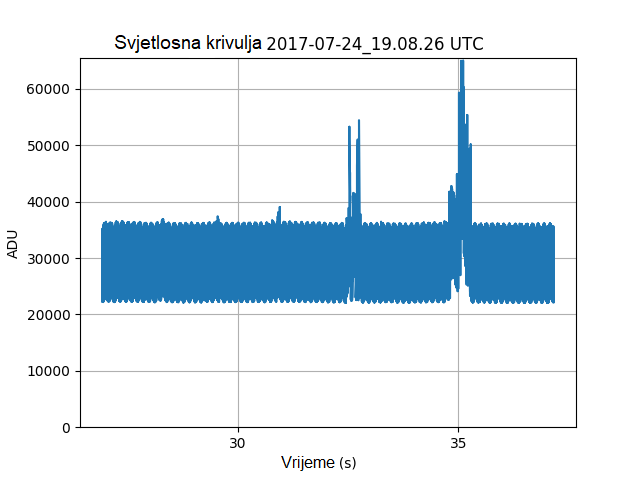
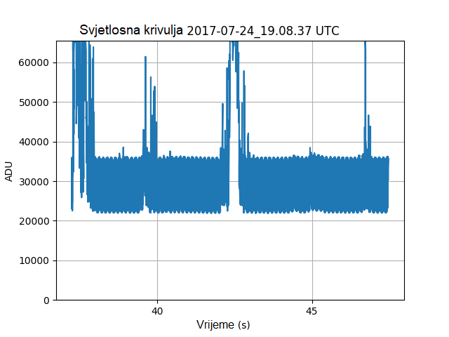
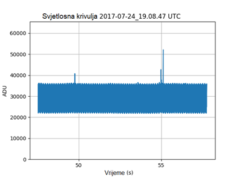
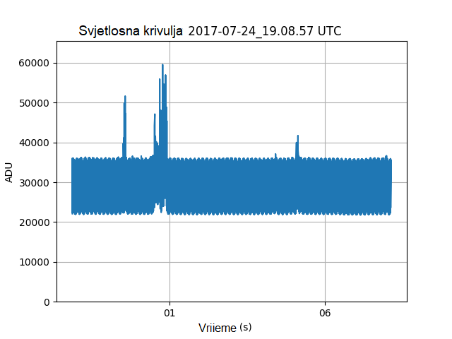
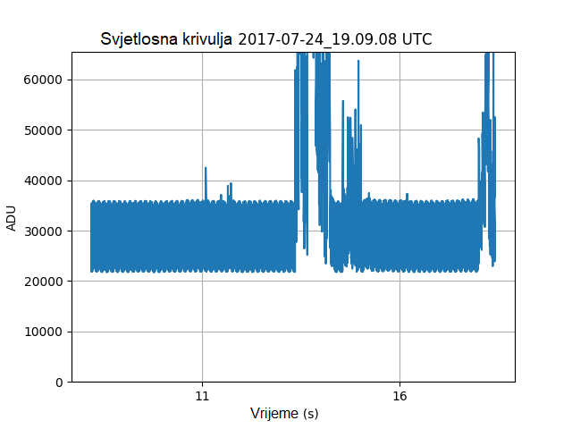
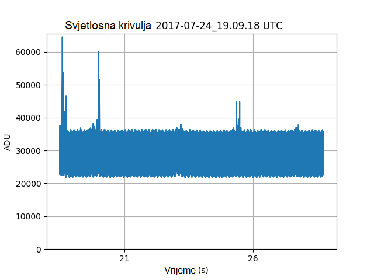

## 4. Noise filter (mains flicker)

Since a perfectly dark location is hard to find, the street-lamp signal is filtered in software
with a moving average ([`scipy.signal.lfilter`](https://docs.scipy.org/doc/scipy-0.18.1/reference/generated/scipy.signal.lfilter.html)).

Add at the start of the recording script:

```python
from scipy.signal import lfilter

n = 150
b = [1.0 / n] * n
a = 1
```

Then filter the data before plotting:

```python
yy = lfilter(b, a, data_array)   # after the data is collected
plt.plot(times_array, yy)        # plot the filtered signal instead of the raw one
```

Signal with noise (raw):

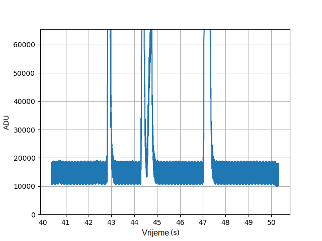

Signal after the filter:

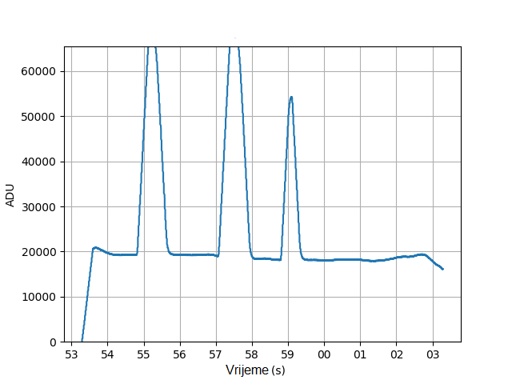

## 5. CSV format

Data is saved as comma-separated values. Each file holds one 10-second block, with the 16-bit
value of each sample (500 per second). Example:

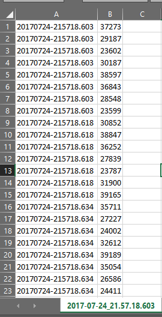

## Conclusion

The radiometer can measure, analyze and display various light phenomena.
Future work is listed in the main [README](../README.md#future-improvements).
