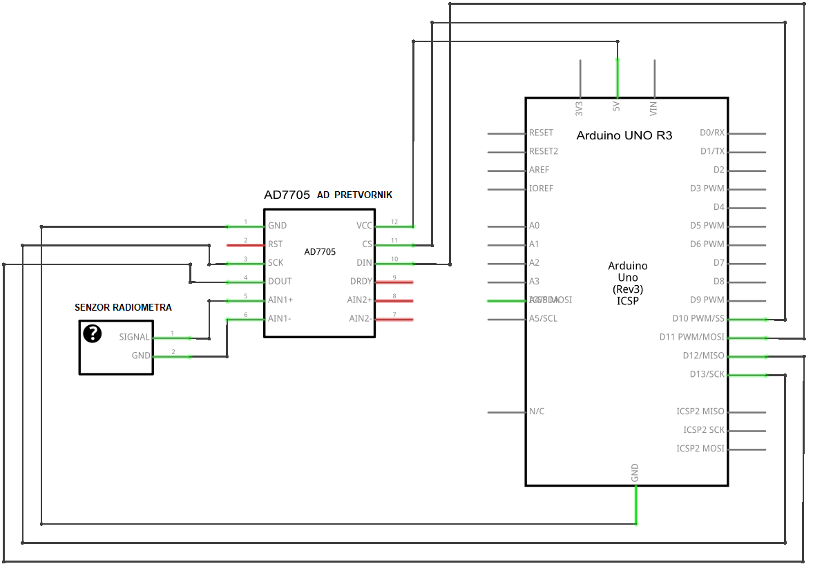
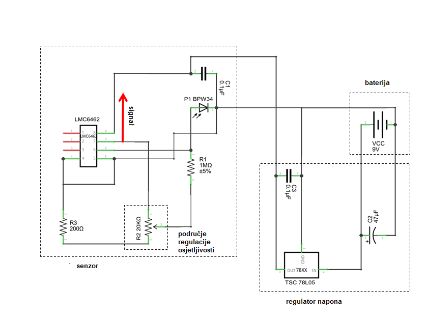
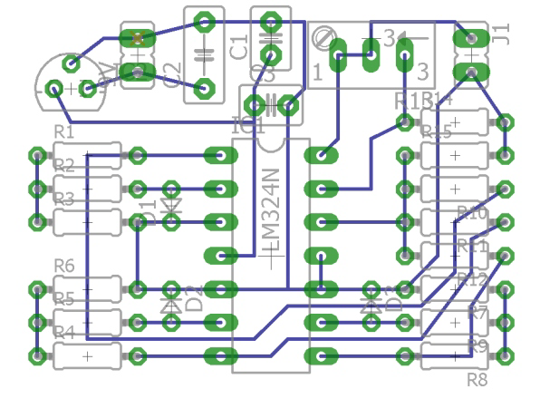
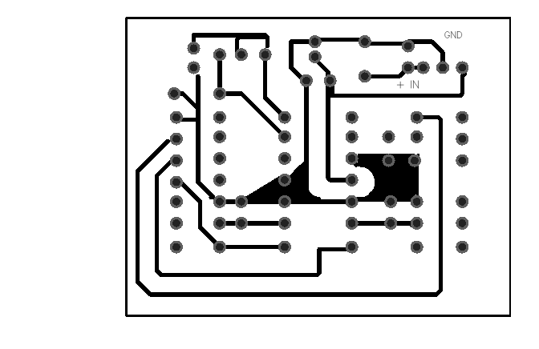
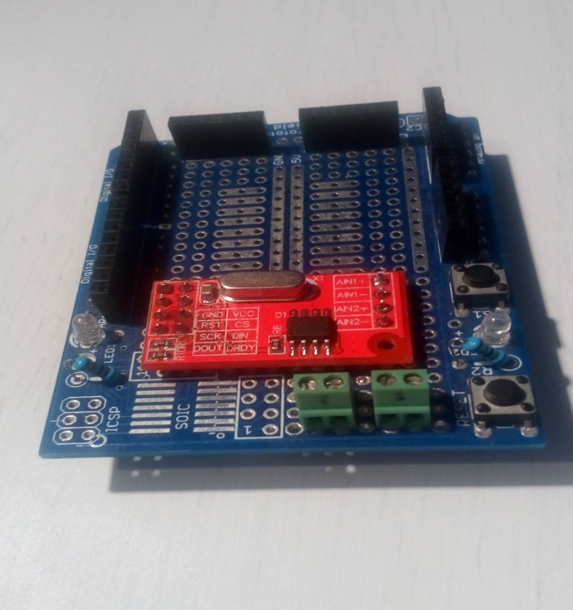
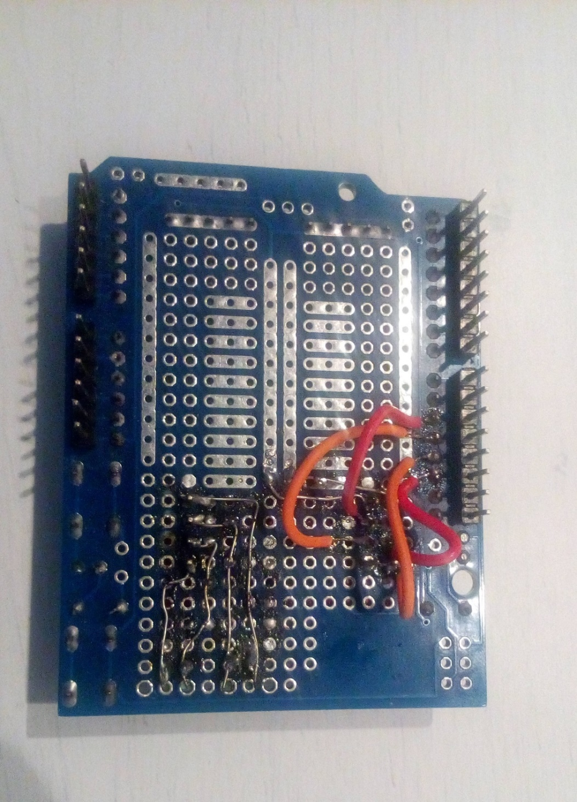
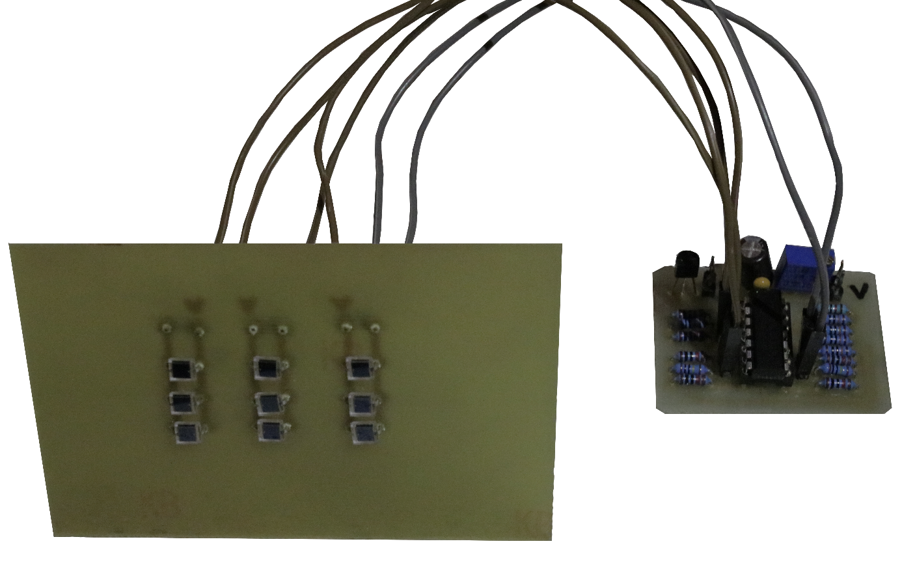
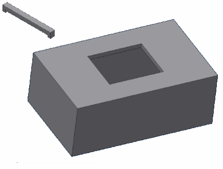

# Schematics and construction

The original drawings (thesis section 3) are in [`hardware/schematics/`](../hardware/schematics/):

| Figure | Content | File |
|--------|---------|------|
| 3.1 | Block diagram | `block_diagram.png` |
| 3.2 | Electrical schematic | `electrical_schematic.png` |
| 3.3 | Assembly drawing of the sensor board (scale 2:1) | `sensor_assembly.png` |
| 3.4 | PCB layout of the sensor board (scale 2:1) | `sensor_pcb.png` |

## System overview

```
Sensor -> AD7705 converter -> Arduino -> Computer (Python program)
```



## Electrical schematic



## Components

**Arduino Uno R3**: ATmega328 microcontroller board. It reads the ADC and sends data to the PC over serial.

**AD7705 ADC**: 16-bit analog-to-digital converter with two independent channels,
sampling at 500 Hz, input range 0 to 5.75 V. Only channel AIN1 is used.

**BPW34 photodiodes**: chosen for their large active area (7.8 mm²) and high sensitivity
near the infrared part of the spectrum. Six are used, two in parallel per input.

**LMC6462 op-amp**: 14-pin rail-to-rail output amplifier that amplifies the photodiode current.
Photodiode inputs are on pins 2/3, 5/6 and 9/10 (anode/cathode), and the amplified
output is on pin 14, which goes to a trimmer potentiometer that sets the sensitivity.

**5 V voltage regulator**: provides stable 5 V from the 9 V battery. The 5 V is also routed to the
output connector, so it is available to the Arduino side.

## Signal path

1. Light hits the photodiodes and produces a small current.
2. The op-amp amplifies it, and the trimmer sets the overall gain.
3. The amplified signal goes to the AD7705, which digitizes it into a 16-bit value (0 to 65535).
4. The Arduino splits each 16-bit value into two bytes and sends them over serial
   (115200 baud). The Arduino can only send 8 bits at a time, so Python reassembles
   them as `value = low_byte + high_byte * 256`.

## Assembly

- Components were soldered onto an Arduino ProtoShield.
- The AD7705 is wired to the Arduino with insulated wire (see the pin table in the [README](../README.md#arduino-to-ad7705-wiring)).
- The sensor is on its own PCB, and the photodiodes sit on a separate small board
  connected to the sensor with wires.

| Sensor board: assembly | Sensor board: PCB layout |
|:---:|:---:|
|  |  |

| Shield, front | Shield, back |
|:---:|:---:|
|  |  |

Sensor connected to the photodiode board:



## 3D-printed housing

To keep stray light away from the photodiodes (for example from the Arduino's LEDs),
a housing was designed in CAD and printed on a 3D printer. It separates the photodiode
board from the rest of the electronics.



## Converting readings to voltage

```
voltage = (reading / 65535) * 5 V
```

Example: a reading of 50000 corresponds to (50000 / 65535) * 5 V = **3.81 V**.
